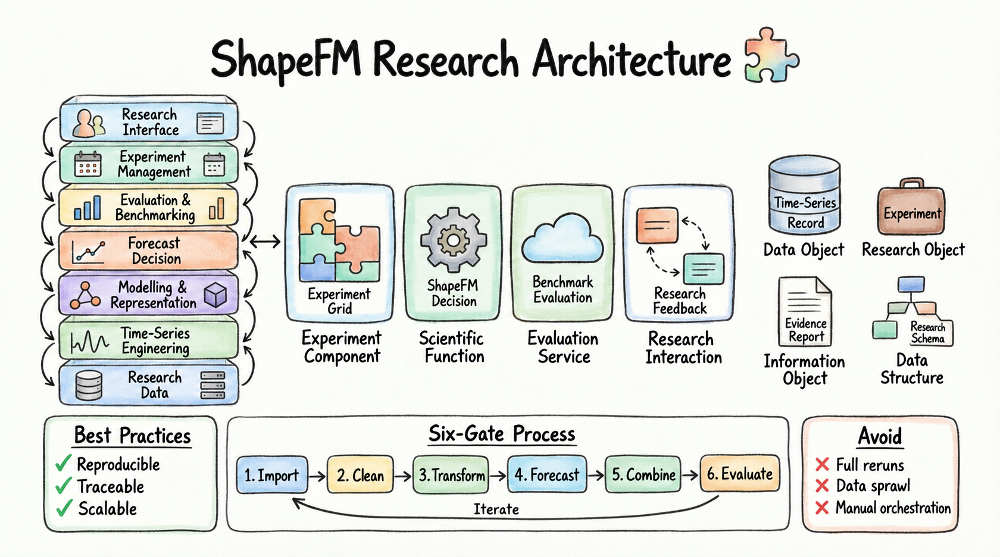
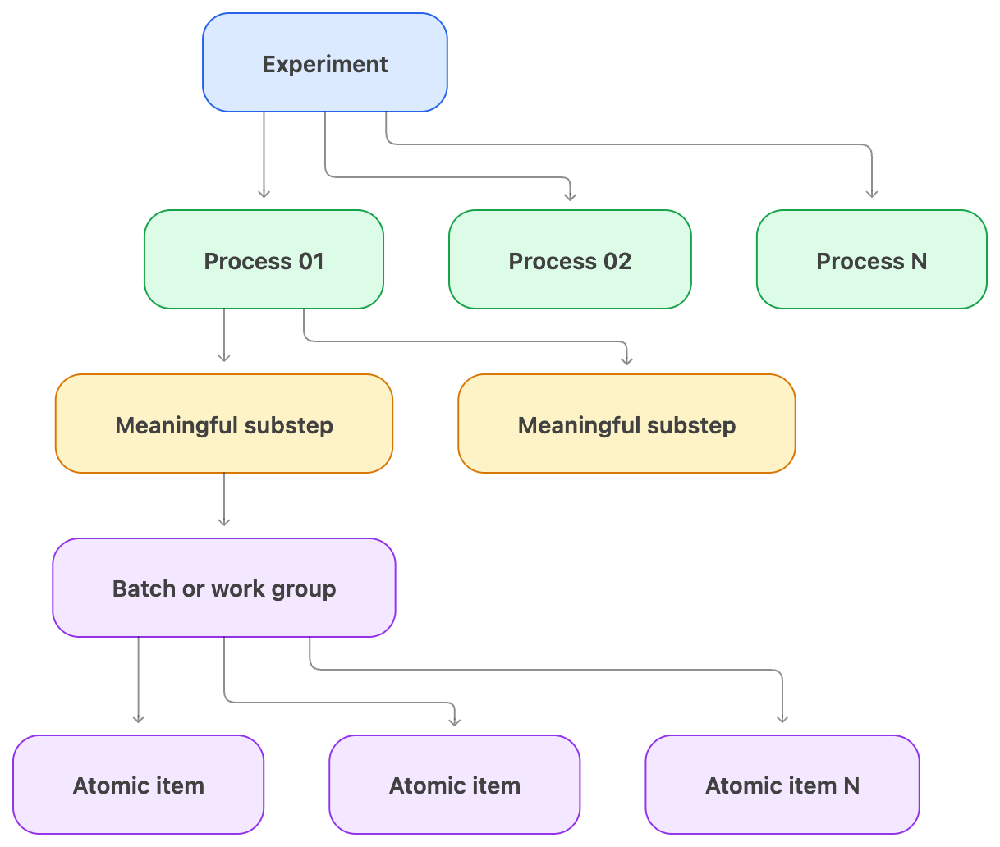
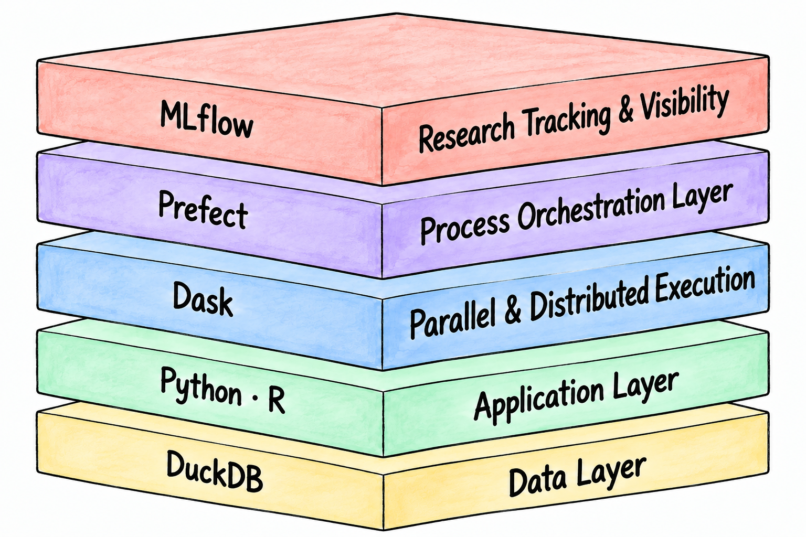

# ShapeFM architecture

ShapeFM is one research workflow, not a collection of model-specific runners.
The architecture is designed to be simple, restartable, parallel where useful,
and transparent to the researcher.



## Six processes

```text
01 Import → 02 Preprocess → 03 Transform → 04 Forecast → 05 Combine → 06 Evaluate
```

| Process | Owns | Durable completion |
| --- | --- | --- |
| 01 Import | Register GIFT-Eval population, materialise canonical series and accept the dataset. | Accepted series items in `experiment.duckdb`. |
| 02 Preprocess | Apply the selected cleaning mode to historical observations. | Accepted prepared series in `experiment.duckdb`. |
| 03 Transform | Assign membership; create modelling inputs and reusable features. | Rolling inputs in `windows.duckdb`; membership/features and summary state in the parent. |
| 04 Forecast | Run forecast providers and train/load/predict expensive meta-learners. | Forecasts, directional predictions and model-artifact metadata. |
| 05 Combine | Resolve stored component forecasts and apply an approved combination. | Combined forecast plus component identities and weights. |
| 06 Evaluate | Calculate approved metrics, sensitivity, tables and derived exports. | Evaluations/tables in DuckDB; figures/CSVs under `results/`. |

All models plug into this workflow. DTW, Mantis, Chronos, R forecasts and
combinations do not own separate experiment runners.

## Workflow hierarchy



```text
Experiment
  └─ Process
      └─ meaningful subflow
          └─ bounded work group
              └─ atomic scientific item
```

This hierarchy is mandatory. Preserve the following approved subflows and order;
internal helpers are not additional research milestones. Administrative subflows
retain their own durable reference/acceptance boundary without inventing parallel
scientific work.

| Process | Ordered meaningful subflows |
| --- | --- |
| 01 | 01.01 Register source population → 01.02 Materialise canonical series → 01.03 Accept canonical dataset |
| 02 | 02.01 Materialise prepared histories → 02.02 Accept prepared dataset |
| 03 | 03.01 Assign research membership → 03.02 Materialise modelling inputs → 03.03 Materialise reusable features → 03.04 Accept modelling dataset |
| 04 | 04.01 Materialise individual forecasts → 04.02 Materialise representations → 04.03 Fit decision models → 04.04 Materialise directional predictions → 04.05 Accept forecast pool |
| 05 | 05.01 Materialise forecast combinations → 05.02 Materialise approved deployable adjustments → 05.03 Accept forecast candidates |
| 06 | 06.01 Evaluate forecast accuracy → 06.02 Evaluate directional performance → 06.03 Materialise diagnostic surfaces → 06.04 Select and retain diagnostics → 06.05 Assemble research results → 06.06 Publish approved outputs → 06.07 Accept experiment |

## Five technical layers



The five layers, bottom to top, are:

1. **DuckDB data layer** owns scientific state and durable restart; only the
   selected coordinator writes it.
2. **Python/R application layer** owns scientific objects and calculations,
   independent of Prefect, Dask and MLflow.
3. **Dask execution layer** schedules bounded work groups locally or across
   configured machines. Scientific objects do not know where they execute.
4. **Prefect orchestration layer** owns experiment, process and meaningful
   subflows, operational attempts and failures.
5. **MLflow Research Tracking & Visibility** projects milestones and curated
   final comparisons; it never governs scientific acceptance.

ShapeFM inherits orchestration, scheduling and transactions from these building
blocks. It does not build a second scheduler, queue, retry system, transaction
protocol or validation framework around them.

## Normal item path

```text
repository reads pending identities
  → application object forms ordinary input
  → local or Dask execution calls the same scientific function/provider
  → ordinary result returns to coordinator
  → repository commits result and completion atomically
```

Dask placement, network transport and worker discovery are infrastructure
details. Workers never write the research databases.

## Storage and authority

One experiment uses fixed paths:

```text
config/experiment.json          creation-time bootstrap
results/experiment.duckdb       parent: configuration, canonical data, state,
                                membership, features, representations,
                                forecasts and evaluations
results/windows.duckdb          child: rolling/high-volume modelling inputs,
                                transformed windows and their labels
results/tables/                 derived human-readable tables
results/figures/                derived figures
models/directional_dtw/daily/model.pickle
models/directional_mantis_rf/daily/horizon_01.pickle ... horizon_14.pickle
.runtime/prefect/               operational Prefect state
.runtime/dask/                  operational Dask state
.runtime/mlflow/                operational tracking and published artifacts
```

The runtime opens/creates the parent when opening an experiment; Process 03 alone
creates the child when needed. Exactly these two scientific databases are used.
No third scientific database, experiment-named
database or evidence database is part of the architecture. Names, dates and
scientific identity live inside DuckDB, not in filenames.

Configuration enters once and is stored in the parent; resume loads that record.
Generated databases are disposable: no schema migration or historical-database
compatibility layer is required.

The normal researcher entry point writes directly to these canonical repository
locations. Temporary test roots clean up after themselves and are not final
researcher experiments; there is no promotion subsystem or `.amp` dependency.

Generated results are disposable and untracked. Git stores code, configuration,
locks and living documentation. External backups are optional researcher
snapshots, not a runtime dependency.

## Restart and progress

DuckDB item commits are restart authority. A restart submits only missing or
failed identities; completed results are not recalculated merely to verify them.
Prefect records operational attempts but does not replace scientific state.

Calculate each scientific atomic item once on its assigned worker. Hardware and
backend are operational provenance, not identity or grounds for recalculation.
Ordinary valid floating-point differences are accepted; no parity gate, workload
or tolerance gate. Provider boundaries check shape and scientifically usable values.

Researcher `status` reads experiment/run identity, accepted process/subflow
milestones and atomic result counts. MLflow supplies operational milestone/error
visibility. Neither display reruns validation or infers a live worker from a
persisted state tag.

One shared executor plans missing atomic keys, divides them into bounded work
groups and accepts pure results through coordinator transactions. A later failure
preserves earlier commits; no accepted atomic key is resubmitted. Only explicitly
configured bounded item retry is allowed, with no hidden scientific fallback.
Workers receive neither writer connections nor MLflow clients; foundation-model
assets are reused from worker-local caches, not downloaded per item.

## Research tracking

The explicit `MLflowResearchTracking` adapter uses the official MLflow package,
one experiment named `ShapeFM` and one resumable run per scientific experiment.
Its run ID is stored in `experiment.duckdb`; supported SQLite state under
`.runtime/mlflow/` is operational, not a third scientific database. The
coordinator logs experiment/process/subflow start, completion and failure,
approved small parameters/tags, aggregate completion progress and curated final
metrics/approved CSV, PNG and PDF outputs. No databases, models or intermediates
are tracking artifacts. Periodic progress/ETA is off by default, enabled only by
a stored setting for an explicitly identified long-running subflow. Tracking
failures emit warnings without invalidating science; later updates use current
DuckDB aggregates without replaying missed events. No nested/worker/item runs,
autologging, system metrics or model registry.

## Validation boundaries

Normal execution validates only:

- external configuration/source input;
- conversion into the canonical object;
- native provider output returning to ShapeFM;
- database transaction/integrity; and
- final expected completion count or dependency.

Trusted internal objects are not repeatedly revalidated. Acceptance checks only
planned atomic identities, accepted predecessors and the required next output
reference. Unlisted MVP behaviour is absent by default: no calibration, tuning,
speculative validation/conversion, benchmark/environment probes, compatibility
paths or monitoring frameworks. New capabilities need researcher approval.

## MVP scope boundary

The architecture is scope-closed: it implements the researcher-approved MVP and
does not silently grow through implementation choices. If an unrequested
capability is necessary to deliver an approved outcome, its need and simplest
form are presented for researcher approval before implementation. Optional
generality, defensive ceremony and anticipated future use remain outside scope.

## Source ownership

```text
src/python/
├── experiment.py
├── p01_import/flow.py
├── p02_preprocess/flow.py
├── p03_transform/flow.py
├── p04_forecast/flow.py
├── p05_combine/flow.py
├── p06_evaluate/flow.py
├── util/runtime.py
├── util/distributed_execution.py
├── util/research_tracking.py
└── tests/
```

Each importable process folder contains its real Prefect `flow.py` and code used
only by that process. Empty parent wrappers, forwarding aliases and process code
hidden in large `shared_*` modules are not the target. `util/` is only for code
used by at least two processes. Both Python and R use `pNN_process` folders and
descriptive `snake_case` filenames, with central tests in `src/python/tests/`
and `src/r/tests/`. Python shared transformations live in
`src/python/util/transformations.py`; process folders use implicit namespace
packages. R workers and process-only helpers live in
their owning process folders. Shared R code lives in
`src/r/util/preprocess_worker.R` and `src/r/util/time_series_input.R`.
The worker prepares full histories for Process 02 and independently cleans local
blocks for Process 03 without future leakage; the input adapter serves Processes
02–04. Both applications obtain the shared worker path from Python
`util/providers.py`, not from another process application. The exact R layout is defined
in [code standards](code-standards.md).

Operational state is confined to `.runtime/{prefect,dask,mlflow}`. The normal
researcher entry point sets `PREFECT_HOME` to repository-root `.runtime/prefect/`
before importing Prefect; the obsolete root `.prefect/` is removed. Model paths
contain model/frequency/horizon names, not scientific experiment IDs. Path
normalization preserves model bytes, accepted scientific state and configuration;
only operational model-path fields in DuckDB change.

## Architecture qualities

- **Simple and pragmatic:** every layer owns a necessary responsibility.
- **Efficient:** no duplicate whole-data passes or routine recalculation.
- **Scalable:** bounded work can move from local to distributed execution.
- **Agnostic:** scientific code does not know host, scheduler or database path.
- **Resilient:** Prefect exposes failures; DuckDB commits accepted items
  atomically; restart resumes the delta.
- **Observable:** progress follows the research hierarchy.
- **Scientifically stable:** operational topology never changes scientific
  identity or triggers recalculation of accepted results.

This architecture is the accepted baseline for POC2, later ShapeFM POCs and
future research projects unless the researcher explicitly approves a change.
