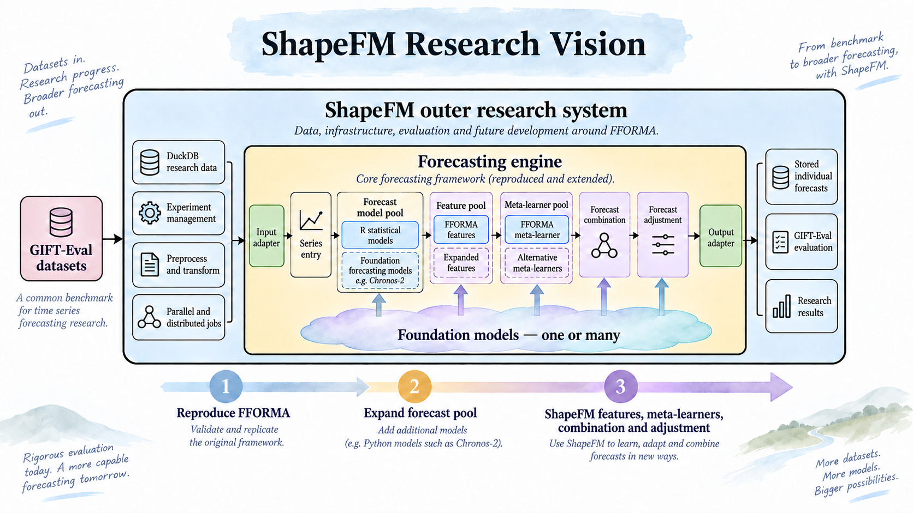

# ShapeFM research vision

ShapeFM is a reproducible time-series research system. Its outer system owns
data, experiments, execution, evaluation and evidence. Its inner forecasting
engine begins with a reproducible FFORMA baseline and then expands the forecast,
feature, meta-learner, combination and adjustment pools.

## Research system

The outer system owns:

- canonical GIFT-Eval data and experiment identity;
- preprocessing, transformations and evaluation windows;
- restartable local and distributed execution;
- individual forecasts, fitted meta-learners and evaluation results; and
- comparable tables and figures derived from stored results.

The forecasting engine is accessed through standard input and output contracts.
R and Python providers keep their native internal objects. The rest of ShapeFM
does not need to know how a particular provider fits or predicts.

## Research progression

1. **POC2 — trusted Daily building blocks.** Establish the architecture and
   reproduce the agreed M4 Daily Table 1, Daily-only Table 2 and Figure 2 scope.
2. **POC3 — complete M4 reproduction.** Reuse the same six processes for all M4
   frequencies, complete Table 2 and the approved applicable figures. This is a
   scale/configuration transition, not an architecture rewrite.
3. **POC4 — ShapeFM research.** Add new representations, features,
   meta-learners, combinations and adjustments while retaining the reproduced
   baselines so effects remain attributable.

POC3 and POC4 are planning direction, not authority to begin implementation.

## Stable research principles

- GIFT-Eval is the canonical benchmark-data authority.
- Individual forecasts remain retrievable and evaluable without refitting.
- A new component expands a pool; it does not silently replace a baseline.
- Scientific identity is independent of worker count, host and completion order.
- Foundation-model roles—forecast, representation, meta-learner, combination or
  adjustment—are explicit.
- Combination preserves its component forecasts.
- Adjustment preserves the unadjusted result and identifies the method applied.
- Every result retains dataset, series, horizon, method, experiment and relevant
  transformation/model provenance.

## Decision test

Before approving a change, identify its owner, input, output, scientific effect,
restart boundary and comparison baseline. If those cannot be stated simply, the
design is not ready.
